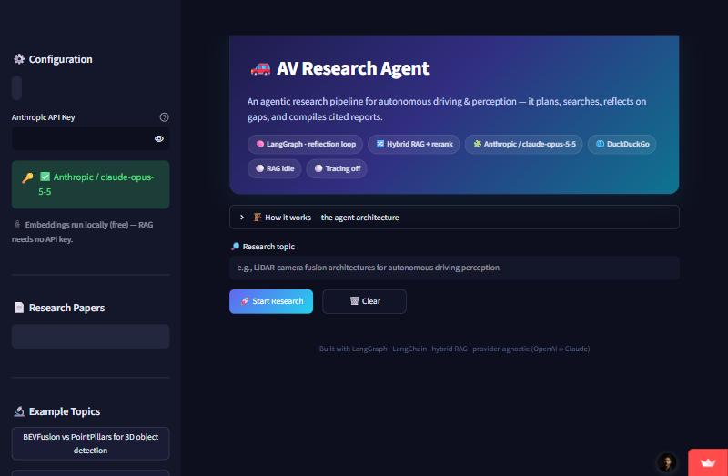
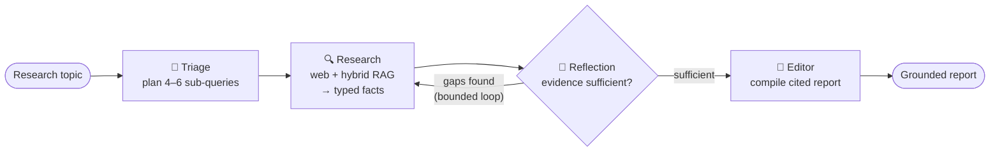
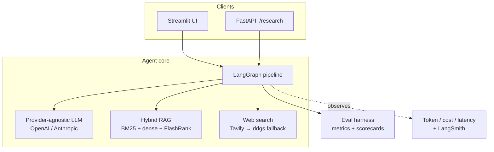

# 🚗 AV Research Agent


**An evaluated, agentic research pipeline for autonomous-driving & perception literature.**
Give it a topic; it plans sub-queries, searches the web and your uploaded papers,
*reflects on evidence gaps and researches deeper*, then compiles a cited report —
with a built-in evaluation harness that measures report faithfulness.

### ▶️ [Live demo](https://av-research-agent-rkxq7reyynlruyc6qddtrw.streamlit.app/) · [REST API](#rest-api) · [Eval harness](#evaluation)



---

## Why this project is interesting (engineering, not a demo)

Most "LLM app" projects are a prompt chain behind a UI. This one is built the way a
production AI system is built:

| Concern | How it's addressed |
|---|---|
| **Is the output actually good?** | An **evaluation harness** scores every report (faithfulness, citation grounding, structure, relevance) and writes versioned scorecards. Grounding the Editor raised measured **faithfulness 0.60 → 0.90**. |
| **Real agency vs. a fixed chain** | A **LangGraph** state machine with a bounded **reflection loop** — the agent decides whether evidence is sufficient and researches gaps if not. |
| **Reliable I/O** | **Pydantic structured outputs** on every agent (no fragile JSON parsing); graceful degradation on every external call. |
| **Retrieval quality** | **Hybrid retrieval** (BM25 + dense) with **cross-encoder reranking** and grounded citations. |
| **Vendor risk** | **Provider-agnostic** — OpenAI ↔ Anthropic via one env var; free local embeddings so RAG needs no API key. |
| **Shippable** | **FastAPI** service, **Dockerfile**, and a one-click Render/Streamlit deploy. |
| **Proven, not claimed** | **27 unit tests** + **GitHub Actions CI** (lint + tests + offline eval) on every push. |
| **Cost/latency visibility** | Per-run **token / cost / latency** tracking; optional LangSmith tracing. |

---

## Architecture

### Agent pipeline (LangGraph)



The `Reflection → Research` edge is conditional and bounded by `max_iterations`,
so the agent digs deeper on hard topics but always terminates.

### System



---

## Evaluation

Quality is measured, not vibe-checked. `evals/run_eval.py` scores reports against a
**20-case golden dataset**:

| Metric | Type | Checks |
|--------|------|--------|
| `citation_coverage` | deterministic | every inline `[citation]` maps to a collected source (catches hallucinated cites) |
| `structure_coverage` | deterministic | required report sections are present |
| `source_grounding` | deterministic | every bibliography entry maps to a real fact |
| `faithfulness` | LLM-as-judge | report claims are supported by the collected facts |
| `topic_relevance` | LLM-as-judge | the report answers the requested topic |

Deterministic metrics run offline with **no API key**; LLM-judge metrics run when a
provider key is set. Each run writes a timestamped scorecard, so any prompt/model/
retrieval change gets a clean **before/after**.

```bash
python -m evals.run_eval            # offline (free)
python -m evals.run_eval --live     # regenerate reports + LLM-judge
python -m evals.benchmark --combos anthropic:claude-haiku-5-5 openai:gpt-4o-mini
```

---

## Quickstart

```bash
git clone https://github.com/adomynx/AV-Research-Agent.git
cd AV-Research-Agent

python -m venv .venv && . .venv/Scripts/activate   # Windows
# source .venv/bin/activate                        # macOS/Linux
pip install -r requirements.txt

cp .env.example .env     # set LLM_PROVIDER + the matching API key
streamlit run app.py     # UI at http://localhost:8501
```

Set `LLM_PROVIDER=openai|anthropic` and the matching `*_API_KEY`. Embeddings run
locally (free); set `TAVILY_API_KEY` for reliable web search.

## REST API

```bash
uvicorn api.main:app --port 8000      # docs at /docs
# POST /research  {"topic": "...", "max_iterations": 2}
# GET  /health
```

## Testing & CI

```bash
pytest          # 27 unit tests: metrics, schemas, utils, dataset integrity
ruff check .    # lint
```

CI (`.github/workflows/ci.yml`) runs lint + tests + the offline eval on every push/PR.

## Docker & deploy

```bash
docker build -t av-research-agent . && docker run -p 8000:8000 --env-file .env av-research-agent
```

- **Render:** New + → Blueprint → this repo (`render.yaml`); set `ANTHROPIC_API_KEY` as a secret.
- **Streamlit Community Cloud:** point at `app.py`, add keys under *Secrets*.

---

## Tech stack

| Layer | Choice |
|-------|--------|
| Orchestration | LangGraph (stateful graph + reflection loop) |
| LLM | OpenAI or Anthropic (configurable) · structured outputs via Pydantic |
| Embeddings | Local FastEmbed (`bge-small-en-v1.5`), free; OpenAI optional |
| Retrieval | Hybrid BM25 + FAISS, FlashRank cross-encoder rerank |
| Web search | Tavily (keyed) → ddgs fallback |
| API / UI | FastAPI · Streamlit |
| Quality | Custom eval harness · pytest · ruff · GitHub Actions |

## Project structure

```
app.py                 Streamlit UI
api/main.py            FastAPI service (/health, /research)
agents/                graph.py (LangGraph) · triage · researcher · reflection · editor
schemas/models.py      Pydantic contracts (ResearchPlan, Fact, FactSet, ReflectionVerdict)
utils/                 llm (provider factory) · rag_engine · web_search · observability · pdf_loader
evals/                 dataset (20 cases) · metrics · run_eval · benchmark
tests/                 27 unit tests
Dockerfile · render.yaml · .github/workflows/ci.yml
```

## Known limitations

- **Web search:** the default DuckDuckGo backend rate-limits bursty agent load; set
  `TAVILY_API_KEY` for reliable search. The agent degrades gracefully regardless.
- **Cost tracking** reports token counts for all providers but dollar cost only for OpenAI.

## License

MIT
